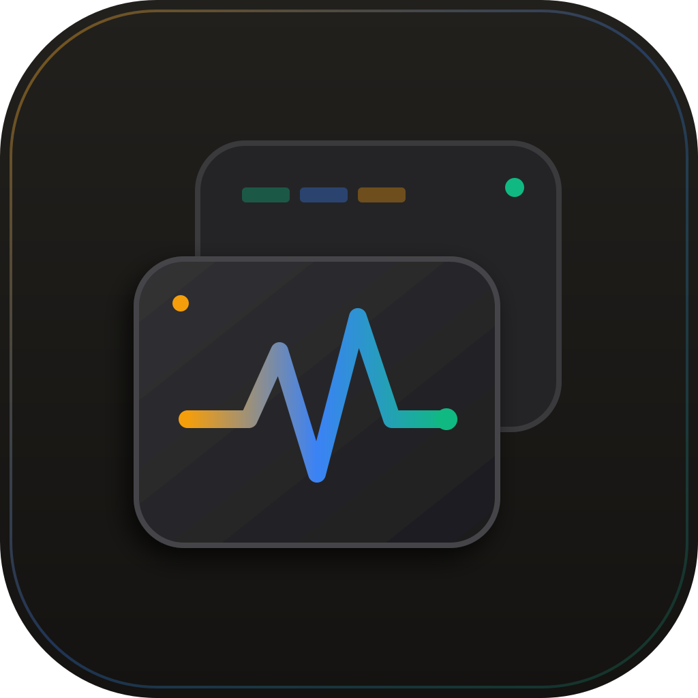
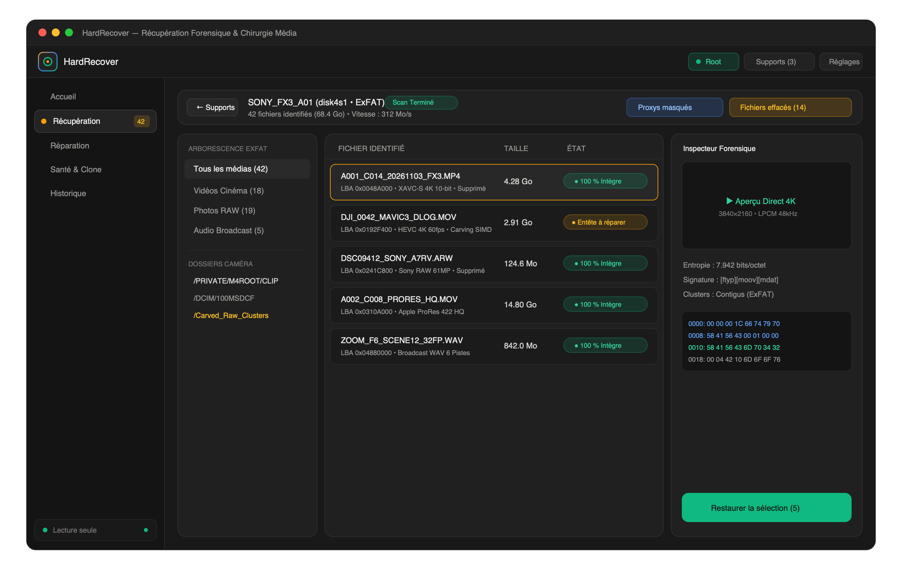
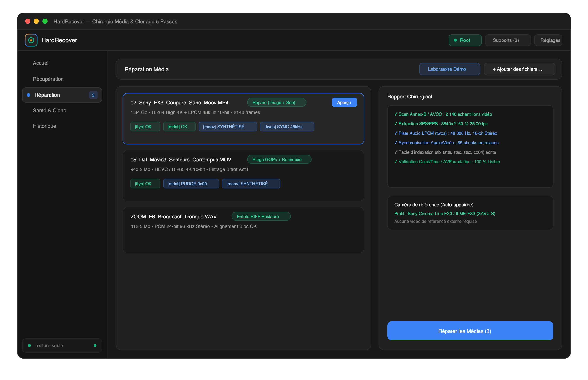

# HardRecover — Forensic Data Recovery & Media Repair for macOS

<p align="center">
  
</p>

<p align="center">
  <strong>Récupération de Supports Physiques, File Carving ExFAT & Reconstruction Chirurgicale de Médias</strong>
  <br />
  <em>Conçu pour les DITs, chefs opérateurs, monteurs et studios de post-production sur macOS.</em>
</p>

<p align="center">
  
  
  
  
  
  
</p>

---

## Écosystème Hard Suite (macOS)

**HardRecover** fait partie de la **Hard Suite**, une collection d'outils natifs macOS dédiés à la sécurité des flux caméra et au sauvetage de médias professionnels :

| Application | Rôle | Fonctionnalités Clés | Dépôt GitHub |
| :--- | :--- | :--- | :--- |
| **[Hardback](https://github.com/Ward-Milan/hardback)** | **Ingest & Prévention (Tournage)** | Déchargement multi-destinations en cascade, vérification physique `F_NOCACHE` bit-à-bit (XXH64, XXH3, SHA-256), manifestes ASC-MHL & compagnon barre des menus. | [Ward-Milan/hardback](https://github.com/Ward-Milan/hardback) |
| **[HardRecover](https://github.com/Ward-Milan/hardrecover)** | **Sauvetage & Réparation (Urgence)** | Récupération de cartes formatées (ExFAT/Carving), reconstruction d'entêtes vidéo/audio tronqués sans ré-encodage, clonage 5 passes `.img` et diagnostic S.M.A.R.T. | [Ward-Milan/hardrecover](https://github.com/Ward-Milan/hardrecover) |

---

## Téléchargement Direct (DMG)

Le package d'installation autonome macOS (Apple Silicon) est prêt à l'emploi :

<p align="center">
  <a href="https://github.com/Ward-Milan/hardrecover/releases/latest/download/HardRecover_1.0.0_macOS.dmg">
    
  </a>
</p>

### Installation sur macOS
1. Téléchargez et ouvrez **[`HardRecover_1.0.0_macOS.dmg`](https://github.com/Ward-Milan/hardrecover/releases/latest/download/HardRecover_1.0.0_macOS.dmg)** (ou directement depuis le dépôt : [HardRecover_1.0.0_macOS.dmg](HardRecover_1.0.0_macOS.dmg)).
2. Glissez-déposez **HardRecover.app** dans votre dossier **/Applications**.
3. *Note de sécurité macOS* : S'agissant d'un binaire open-source distribué sans signature payante Apple Developer, faites **Clic droit > Ouvrir** au premier lancement (ou autorisez l'application dans *Réglages Système > Confidentialité et sécurité > Ouvrir quand même*).

---

## Conçu en Vibe Coding

HardRecover est développé en **Vibe Coding** avec **Google Antigravity** en pair-programming assisté par IA.

Du parseur binaire d'entrées de répertoires ExFAT en Rust, à la synthèse d'atomes ISO-BMFF (`moov` / `stbl`) avec synchronisation audio LPCM (`twos`/`sowt`) et purge de secteurs corrompus sur flux H.264/HEVC, jusqu'au cloneur résilient 5 passes en lecture seule (`O_RDONLY` / `F_NOCACHE`), l'architecture a été conçue et validée sur de véritables rushs caméras endommagés.

---

## Aperçu de l'Interface

### 1. Atelier Récupération — Exploration ExFAT & File Carving
Identification des fichiers supprimés avec restitution des noms d'origine ExFAT, filtrage automatique des fichiers proxys caméra (`.LRF`, `.THM`), indicateurs d'intégrité et inspecteur hexadécimal.



### 2. Atelier Réparation — Reconstruction Chirurgicale Vidéo, RAW & Audio
Synthèse d'atomes `moov` et tables d'échantillonnage `stbl` à la volée, synchronisation audio LPCM (`twos`/`sowt`), purge des GOPs corrompus par bitrot et lecteur d'aperçu intégré.



---

## Fonctionnalités Techniques

### 1. Récupération Forensique & File Carving (`O_RDONLY` / `F_NOCACHE`)
* **Lecture seule stricte** : Accès direct aux volumes et périphériques blocs `/dev/rdisk*` sans aucune écriture sur le support source.
* **Décodage ExFAT natif** : Analyse des entrées de répertoires (`0x85`, `0xC0`, `0xC1`) pour restaurer le nom exact et l'arborescence d'origine des rushs effacés.
* **Carving par signatures & Entropie de Shannon** : Détection bas-niveau des conteneurs `.MOV`, `.MP4`, `.MXF`, `.BRAW`, `.R3D`, `.ARW`, `.CR3`, `.NEF`, `.DNG` et `.WAV` avec évaluation de densité d'information $H(X)$.

### 2. Chirurgie Média Sans Ré-encodage
* **Sony XAVC-S / XAVC-HS & Cinema Line** : Reconstruction complète du conteneur ISO-BMFF après coupure d'alimentation, extraction des paramètres SPS/PPS/VPS et ré-indexation synchrone des pistes audio LPCM 48 kHz 16/24-bit entrelacées.
* **DJI 4K / 5.4K (H.264 & HEVC)** : Filtrage automatique des secteurs corrompus par bitrot (`0x00` / `0xFF`) au sein du flux `mdat` pour éliminer les retours en arrière ou blocages de décodage.
* **Apple ProRes & Blackmagic RAW** : Détection des signatures de trames (`icpf`, `apch`, `apcn`, `ap4h`) et reconstruction des index temporels.
* **Audio Broadcast WAV / BWF** : Inférence automatique des paramètres PCM (fréquence d'échantillonnage, canaux, profondeur de bit) et régénération d'entête RIFF sur prises de son coupées.

### 3. Clonage 5 Passes & Diagnostic de Surface
* **Imagerie de secours (`.img` + `.hrmap`)** : Clonage adaptatif en 5 phases (*Sweep*, *Trim*, *Scrape*, *Retry*, *Map*) avec saut exponentiel sur secteurs défectueux pour sécuriser les supports instables avant défaillance totale.
* **Montage virtuel sécurisé** : Montage de l'image `.img` en lecture seule dans le Finder macOS (`hdiutil attach -readonly`).
* **Profilage de latence NAND** : Cartographie de temps de réponse microseconde permettant d'isoler les cellules flash fatiguées et de vérifier l'authenticité de la capacité physique.
* **Certificat d'expertise** : Export de rapports d'inspection complets avec empreintes SHA-256 et XXH3-64.

---

## Architecture du Projet

```text
HardRecover/
├── assets/
│   └── screenshots/              # Captures d'écran de l'interface
├── src/                          # Interface Utilisateur (React 18 + TypeScript + Tailwind CSS)
│   ├── App.tsx                   # Interface principale (Accueil, Récupération, Réparation, Santé, Historique)
│   ├── ToolInfoModal.tsx         # Fiches techniques des moteurs d'analyse
│   ├── toolInfo.ts               # Documentation technique intégrée
│   ├── Logo.tsx                  # Identité visuelle vectorielle HardRecover
│   ├── types.ts                  # Modèles de données TypeScript
│   ├── styles.css                # Thème sombre macOS (#191919)
│   └── main.tsx                  # Point d'entrée React
├── src-tauri/                    # Moteur Natif Rust (Tauri v2)
│   ├── Cargo.toml                # Dépendances Rust (tokio, xxhash-rust, sha2, sysinfo, libc)
│   ├── tauri.conf.json           # Configuration Tauri v2 et bundle DMG
│   └── src/
│       ├── carver.rs             # Moteur File Carving SIMD & parseur d'entrées ExFAT
│       ├── media_repair.rs       # Chirurgie ISO-BMFF (MP4/MOV), LPCM, ProRes, RAW & WAV
│       ├── imager_health.rs      # Cloneur 5 passes (.img), diagnostic NAND & certificats
│       ├── math_engine.rs        # Entropie de Shannon, divergence JS & autocorrélation PCM
│       ├── volumes.rs            # Détection matérielle macOS (diskutil / IOKit) & élévation Root
│       ├── settings_history.rs   # Persistance locale des sessions et préférences
│       └── lib.rs                # Commandes IPC Tauri et tests unitaires
├── app-icon.svg                  # Icône vectorielle haute définition (1024×1024)
├── HardRecover_1.0.0_macOS.dmg   # Installateur autonome macOS
├── LICENSE                       # Licence Open-Source MIT
└── README.md                     # Documentation du projet
```

---

## Compilation & Développement Local

### Prérequis
* **macOS** 11.0 (Big Sur) ou supérieur
* **Node.js** >= 20 & **npm**
* **Rust** (toolchain stable `cargo` >= 1.77)

### Installation et lancement
```bash
git clone https://github.com/Ward-Milan/hardrecover.git
cd hardrecover
npm install
npm run tauri dev
```

### Générer le package d'installation (.dmg)
```bash
npm run tauri build -- --bundles dmg --no-sign
```

---

## Licence

Distribué sous licence open-source **MIT**. Consultez le fichier [LICENSE](LICENSE) pour plus d'informations.
